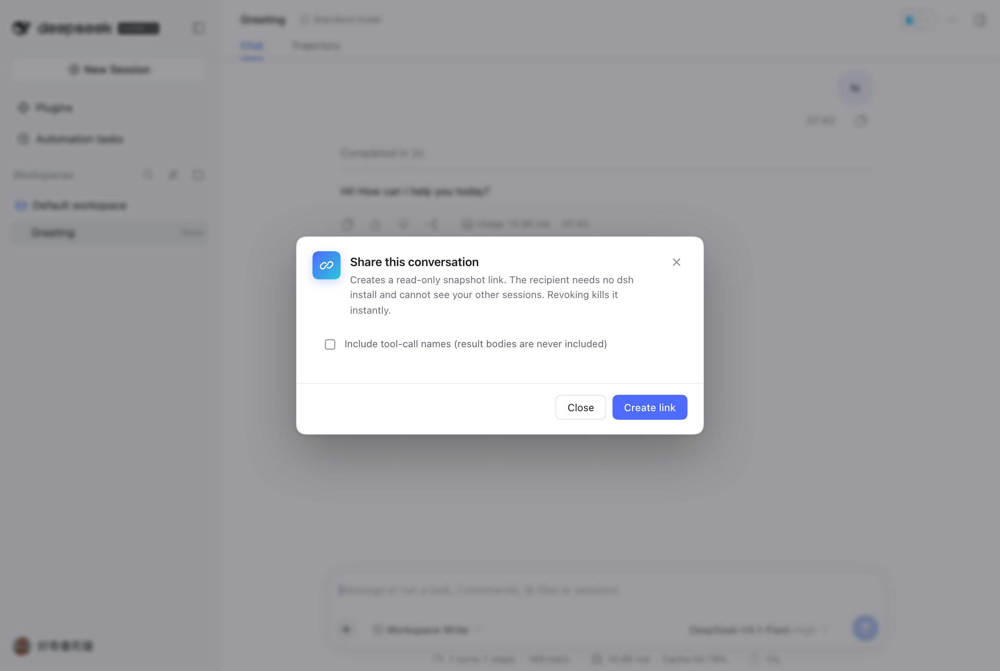
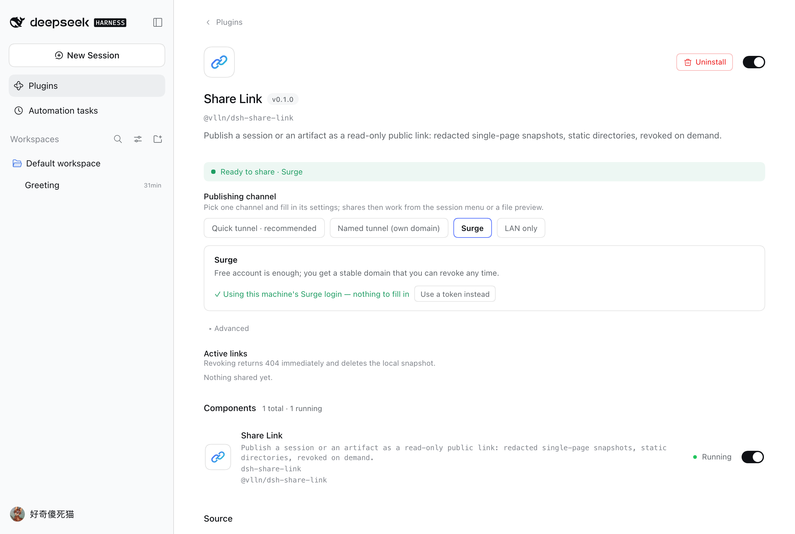
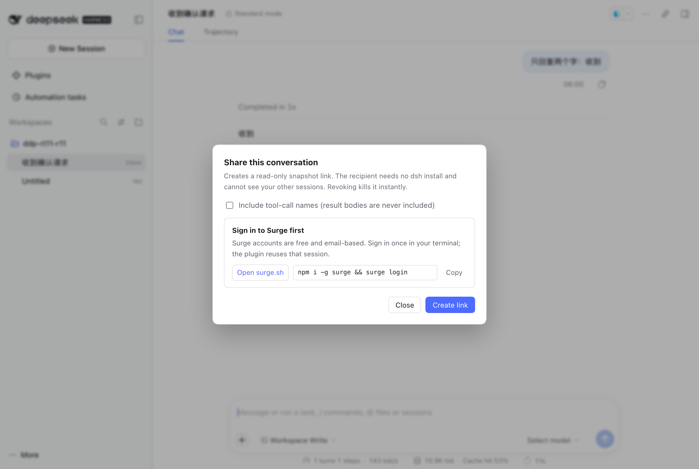

# dsh-share-link

<p align="center">把一个产物（会话快照 / HTML / Markdown / 目录）发布成只读公网链接：一条命令出 URL，撤销即失效。</p>

## 为什么需要它

dsh 是跑在本机的 harness，产物却经常要给别人看：一段对话要发给同事评审、一个 HTML 页面要在手机上打开、一份生成的报告要给客户。

现在你只有两条路，都不对：

- **导出成文件再发**——对方收到的是附件，手机上打开体验差，也没有"同一地址随时更新"；
- **把整个 dsh 穿透出去**——别人拿到的是你的**产品实例**（能下发指令、能看别的会话），而不是**这一个产物**。

这个插件补的是第三件事：**单产物 → 链接**。它只暴露一个静态目录，不代理 GUI、不提供写接口。链接的生命周期绑定在一个本地服务 + 一条 cloudflared 隧道上，进程停或点撤销，链接立刻 404。

## 它长什么样

会话右上角 `···` 菜单里多一项「分享会话…」（入口只有这一处，不额外占图标）；产物在文件预览的工具条上。





对方打开是这样一份只读快照（不加载任何外部资源，内联脚本只服务于复制按钮；默认脱敏）：


## 装

```sh
# 本地 tarball（本仓库 `pnpm build && pnpm pack` 的产物）
dsh plugin --profile web add ./vlln-dsh-share-link-0.1.0.tgz

# 发布到 npm 之后（或 git 源）
dsh plugin --profile web add @vlln/dsh-share-link
```

装完**重启 `dsh web`** 才生效。

首次分享公网链接时会自动把 `cloudflared` 下到 `$DSH_HOME/share-link/bin/`（macOS / Linux）；已有的话把它放进 `PATH` 或配置 `cloudflaredPath` 即可跳过下载。

## 用起来是什么样

**会话**：右上角 `···` → 「分享会话…」→ **选通道**（默认通道预选，未配好的通道置灰）→ 勾不勾"包含工具调用名称" → 生成链接。对方打开看到的是只读时间线：你的提问、助手的回答，没有工具结果正文，没有系统提示，没有其他会话。

**产物**：文件预览（右侧栏）和交付物列表里的文件多一个「分享」按钮 → 直接发布这个文件。`.html` 挂在链接根路径；`.md` 会被渲染成可读页面（不是下载裸文本）；目录要求含 `index.html`。

**Agent 主动发**：对话里说"把这个页面分享出去"，agent 会调 `share_artifact`；说"把这段对话分享出去"会调 `share_session`，回复里直接给出链接和撤销指令。

生成后对话框里直接有 `Copy` / `Open` / `Revoke`：撤销是即时生效的（本地目录删掉 → 同一个 URL 立刻 404），不用去翻命令行。

## 配置与管理：侧边栏 Plugins → Share Link

一个地方管完，**默认零配置可用**：


- 顶部一条状态：绿色「可以分享 · 默认通道」或黄色「还不能分享 · 缺什么」。
- 「默认通道」只决定**分享弹窗里预选哪个**，不是"启用/禁用"——四个通道的配置并存，弹窗里随时换。
- 「快速隧道」标着**推荐**：零配置，dsh 在跑就有链接。
- 每个渠道一张可折叠的配置卡（Surge / 命名隧道），带就绪徽标；没配好的默认展开并给**编号步骤 + 官方入口**：



  本机跑过 `surge login`（凭据在 `~/.netrc`）或设了 `SURGE_TOKEN` 环境变量，Surge 就直接可用；
  想改用 token 才点「Use a token instead」展开输入框。

- 只有该渠道需要的字段才出现；token 类字段默认**以密码形式遮蔽**，旁边「Show / Hide」切换明文。其余字段收进折叠的**高级设置**（端口 / 有效期 / 域名后缀）。
- 参数**即时写入**：失焦或回车就生效，没有"保存"按钮，也不需要在命令行改 YAML。
- 下方「已发布的链接」列出类型、可点开的 URL 和**撤销**——撤销后服务端立刻 404。

## 没有账号 / 没配置时怎么办

分享框打开时会先问一次通道状态（`GET /api/share-link/status`）。**没就绪就直接给引导**，而不是让你点了才失败：



- 标题 + 一句解释 + **可点的官方入口**（`surge.sh` / Cloudflare Zero Trust / cloudflared 下载页）；
- 一条可复制的命令（`npm i -g surge && surge login`）；
- 未就绪时「创建链接」按钮会禁用并改成「先完成上面的配置」，不会让你白点一次；
- 真失败了（比如 token 过期）也落到同一个引导面板，原文错误不再糊在红字里；
- 公网隧道挂了会**明确降级**：链接变成局域网地址，并在结果里标出来。

## 能力面

| 工具 | 说明 |
| --- | --- |
| `share_session` | 把当前会话发布成只读快照（脱敏、去掉注入上下文） |
| `share_artifact` | 发布本地文件或目录；目录需含 `index.html`，单个 `.html` 挂在链接根路径 |
| `share_list` | 列出活跃链接、类型、到期时间 |
| `share_revoke` | 按 id 撤销，链接立即失效、快照文件从磁盘删除 |

配置也可以在 **Plugins → Share Link** 里改（推荐，即时生效）；下面是同一套字段：

| 配置项 | 默认 | 说明 |
| --- | --- | --- |
| `provider` | `tunnel` | `tunnel` = 公网 cloudflared（可撤销）；`lan` = 只给同一局域网；`surge` = Surge 持久域名 |
| `port` | `0` | 只读分享服务端口，0 = 随机（命名隧道模式下自动用 3089） |
| `ttlHours` | `168` | 链接默认有效期（小时）；`surge` 通道靠 `revoke` 撤销，不看到期 |
| `cloudflaredPath` | 空 | 已有 cloudflared 的路径 |
| `tunnelToken` / `tunnelHostname` | 空 | 填了就切 Cloudflare **命名隧道**，地址固定为 `https://<hostname>` |
| `surgeToken` / `surgeDomain` / `surgePrefix` | 空 / 空 / `dsh-share` | Surge 通道：域名是 `<prefix>-<id8>.<surgeDomain 或 surge.sh>`，`revoke` 会调 `surge teardown` |

链接形如 `https://xxx.trycloudflare.com/s/<32 位 token>/`：token 随机、不可枚举；响应带 `no-store` 与 `noindex`，撤销后不会再被缓存命中。

## 安全与数据

- 分享服务只绑 `127.0.0.1`，只认 `GET /s/<token>/…`；**不碰** dsh 的 3080 端口，也没有任何写接口。
- 快照默认脱敏：常见凭据形态（`sk-*`、`ghp_*`、`AKIA*`、`Bearer …`、`api_key: …`）与绝对家目录路径会被替换。**这是尽力而为，不是保证**——业务机密、客户名、内网 IP 挡不住，对外分享前请自己过一眼。
- 会话快照只保留人类输入与助手可见文本；工具调用默认只留名字，工具结果正文、思考块、系统提示一律不投影。
- 分享页顶栏有「**复制正文**」（复制整段内容，不是链接），代码块自带「复制」按钮；页面底部有一张 **GitHub Star** 卡片。两者都是页面内联脚本，不请求任何外部域名。
- 会话数据、分享文件都在 `$DSH_HOME/share-link/`，删除即撤销；`meta` 索引在 `index.json`。
- 公网隧道 = 把一个静态目录暴露到互联网。用完 `share_revoke` 或停掉 dsh web，链接立刻失效。

## 已知限制

- 只支持 macOS / Linux（cloudflared 下载走 `tar`）。
- **命名隧道要求域名托管在 Cloudflare**：命名隧道本身不自带公网域名，必须在 Routes 里加一条 Published application（`<子域>.<你的域名>` → `localhost:3089`）；账号里没有域名时 `Add route` 的 Domain 下拉是空的，这条通道就用不了——改用 Surge 或快速隧道。
- `surge` 通道需要本机有 `surge`（或在 `PATH` 上，否则退回 `npx --yes surge`）并已登录；`tunnelToken` 模式需要隧道在 Cloudflare 侧指向本机固定端口（默认 3089）。
- 目录分享没有 `index.html` 时会生成文件列表页（递归列出相对路径）；列表页只列文件，不列空目录。
- 快速隧道的域名每次重启都会变；要固定地址就配 `tunnelToken` + `tunnelHostname` 走命名隧道。
- 撤销作用在**这份快照**上；已把网页另存或截图的人不受影响。
- 单次分享上限 100 MB / 2000 个文件。
- cloudflared 不可用时会降级成局域网链接（`provider` 仍显示 `lan`），不会静默失败。

## 兼容性

| dsh 版本 | 状态 |
| --- | --- |
| `0.2.1-rc.1` | ✅ 已验证（2026-10-20）：装包、boot、发布产物、发布会话、撤销、公网访问；真实浏览器逐屏点过 `···` 菜单项与文件预览两个入口（截图见上） |
| 同上 · `surge` 通道 | ✅ 逻辑实测（2026-10-20，**用桩可执行文件**验证调用与撤销顺序，未接真实 Surge 账号） |
| 同上 · 命名隧道 | ✅ 逻辑实测（2026-10-20，**用桩 cloudflared** 验证 token 参数、固定端口与 URL 组装，未接真实 Cloudflare 隧道） |
| 其它版本 | ⚠️ 未验证——升级 dsh 后若分享入口不见，多半是 slot 名变了（`conversation.session.header.utilities` / `sidebar.right.tab.document.actions`），或 `dsh-tools` 的 `defineTool` 契约变了 |

> `···` 菜单项是**克隆既有菜单项**注入的（宿主没有菜单项插槽）。如果哪天官方菜单结构变了，这一项会静默消失，header 上的分享图标仍在——这是有意的降级路径，不是崩溃。

## 插件管理

装/卸/启停用官方 CLI：`dsh plugin --profile web add|remove <包>`；已装插件在**侧边栏 Plugins 页**里查看与配置。

## License

MIT
