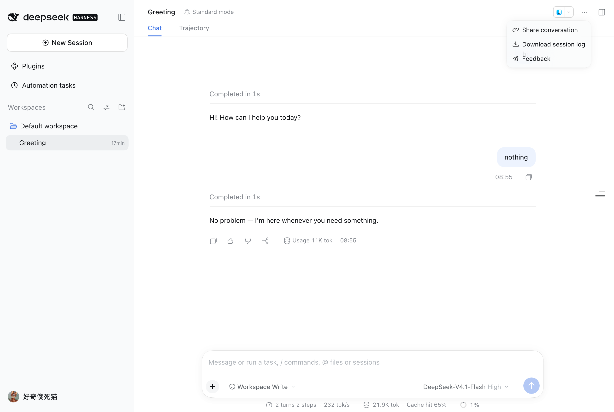
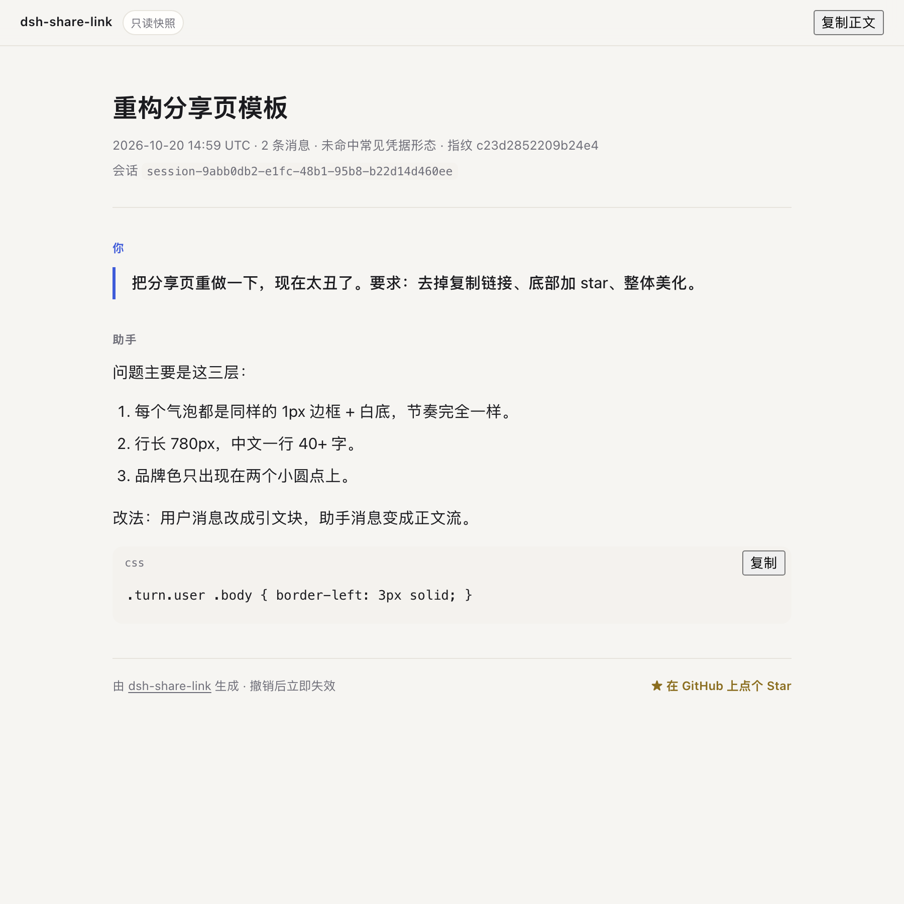
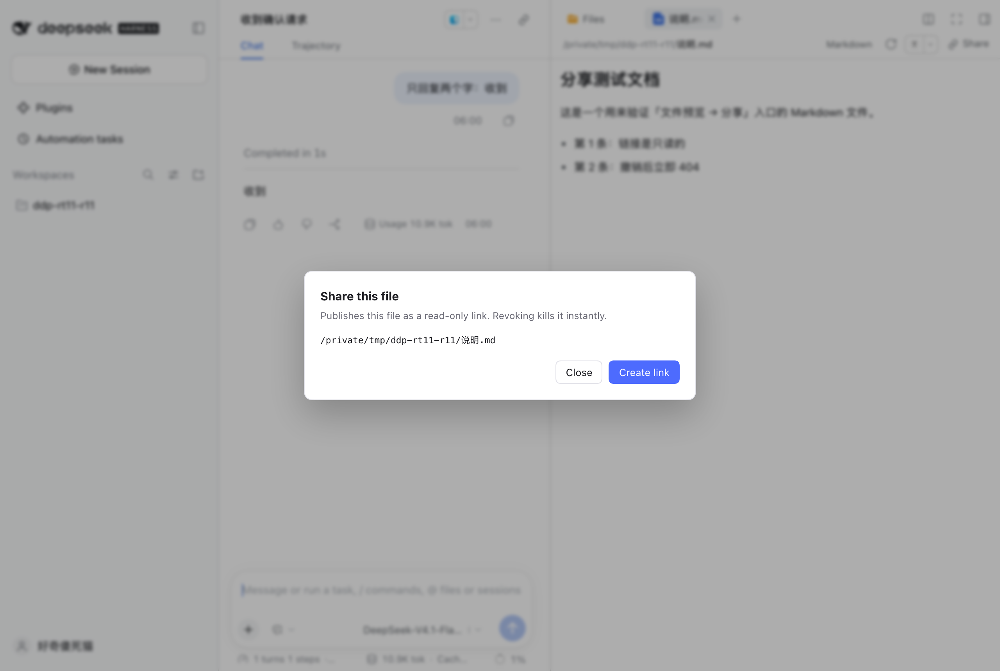
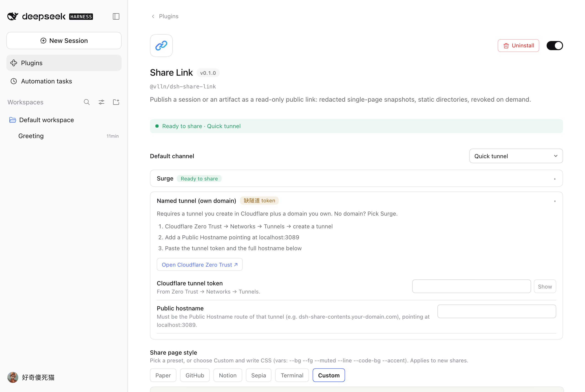
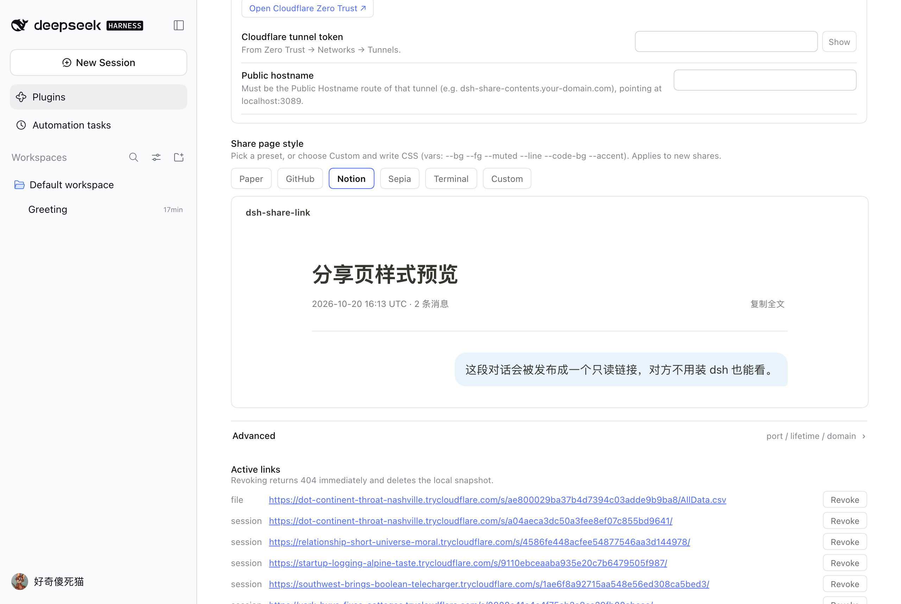

<h1 align="center">&nbsp;dsh-share-link</h1>

<p align="center"><b>把一段对话或一个产物，发布成只读的公网链接</b><br>对方点开就能看，撤销后立即失效。</p>

<p align="center">
  <a href="https://github.com/vlln/dsh-share-link/stargazers"></a>
  <a href="https://github.com/vlln/dsh-share-link/blob/main/LICENSE"></a>
  
</p>

## 装

还没发布到 npm，所以现在用命令行装 **git 源**（构建产物已在仓库里，装完直接用）：

```sh
dsh plugin --profile web add github:vlln/dsh-share-link
```

> 发布到 npm 之后就变成 `dsh plugin --profile web add @vlln/dsh-share-link`，也可以直接在
> **Plugins → Add plugin** 里填包名安装。

- 卸载：`dsh plugin --profile web remove @vlln/dsh-share-link`
- 快速隧道需要一个 `cloudflared` 可执行文件（约 20 MB）：**插件加载后就在后台下载**（跑在插件进程里，退出 dsh 即停）。`Plugins → Share Link` 里有「快速隧道依赖」行：下载进度、是否就绪、版本，右侧「检查」按钮可以手动复查/重试。想跳过下载可以先 `brew install cloudflared`，插件会直接用 PATH 上那份；只用 Surge 的话完全不依赖它

### 装好之后怎么确认

侧边栏 **Plugins** 里出现 **Share Link**，点进去顶部是绿色的 `Ready to share`；打开任意会话，右上角 `···` 里多一项 **分享会话**。

## 为什么需要它

dsh 跑在本机，产物却经常要给外面的人看：一段对话要发给同事评审、一个 HTML 页面要在手机上打开、一份报告要给客户。

现在只有两条路，都不太对：

- **导出成文件再发**：对方拿到附件，手机上体验差，也没法"同一个地址随时更新"；
- **把整个 dsh 穿透出去**：对方拿到的是你的**产品实例**（能下指令、能看别的会话）。

这个插件补的是第三件事：**单产物 → 链接**。它只暴露一个静态目录，在独立端口上跑只读服务，不代理 GUI、不提供写接口。撤销或停掉服务，链接立刻 404。

## 用起来是什么样

https://github.com/user-attachments/assets/5344d279-f8d6-44ec-a380-755b4bb1a062

<sub>26 秒：从 `···` 分享会话 → 生成链接 → 打开发布页。</sub>

### 分享会话



右上角 `···` → **分享会话** → 选通道 → 生成链接。弹窗里可以临时换通道、决定是否保留工具调用名称，生成后能复制、打开、撤销。

对方打开是这样一份对话快照——你的提问靠右成气泡，助手回复是正文流，每条回复可单独复制：



### 分享产物



右侧栏打开文件 → 工具条上的 **Share**。`.html` 挂在链接根路径；`.md` 按 GFM 渲染成可读页面（标题、表格、列表、代码块、图片、链接，以及 README 里那些 `<h1 align="center">`、`<details>` 之类的原始 HTML，过一层标签白名单）；目录会生成文件列表页。

分享 `.md` 时会顺手处理图片：**相对路径**的图（`docs/a.png`）从 md 所在目录树里拷进去，保持相对位置不变；**公网图片**（徽章）在发布时抓下来内联成 data URI，所以页面依然是「一个文件、离线能开」。

> 装了 [dsh-better-sidebar](https://github.com/omdsh-dev/DSH-better-sidebar) 的话，文件由它的编辑器接管，工具条那一排会换成它自己的页头——分享按钮同样在那一行（最右端的链接图标），点开是同一个弹窗。

### 配置与样式



侧边栏 **Plugins → Share Link**，一个地方管完：

- 顶部状态条：现在能不能分享、缺什么
- **默认通道**：只决定弹窗预选哪个
- **快速隧道依赖**：cloudflared 的下载进度与版本，「检查」手动复查/重试
- 渠道配置卡：每个通道自己的参数，互不排斥；没配好的自动展开并给步骤与官方入口
- **分享页样式**：5 种预设 + 自定义 CSS，选完立刻预览
- **已发布的链接**：哪些还活着、一键撤销

| 预设 | 观感 |
|---|---|
| 暖纸（默认） | 米白底、无衬线、蓝色强调 |
| GitHub | 纯白、细边框、系统字体 |
| Notion | 大标题、无边框、超大留白 |
| 散文 | 衬线、米色、行高 1.95 |
| 终端 | 等宽字体、深底、绿色强调 |



选「自定义」可以写 CSS 覆盖这些变量：`--bg` `--fg` `--muted` `--line` `--code-bg` `--accent` `--star`。

## 通道

| 通道 | 地址形态 | 需要什么 | 撤销 |
|---|---|---|---|
| 快速隧道 | `https://随机词.trycloudflare.com` | 无（首次要下 20 MB cloudflared） | 停进程 / 撤销 |
| Surge | `https://dsh-share-<id>.surge.sh` | 免费 Surge 账号（邮箱） | `surge teardown` |
| 命名隧道 | `https://<你的域名>/s/<短码>/` | Cloudflare + 自有域名 | 停进程 / 撤销 |
| 局域网 | `http://<内网 IP>:<port>/s/<短码>/` | 无 | 撤销 |

> 命名隧道不自带公网域名：要在 Cloudflare 的 Routes 里加一条 Public Hostname 指向 `localhost:3089`。没有域名就用 Surge 或快速隧道。

> 链接里的 `<短码>` 是 8 位小写 base36（约 41 bit 熵），路径是 `/s/<短码>/`。嫌不够难猜可以在设置页「高级」里把长度调到 10（约 52 bit）；旧版 32 位 hex 链接仍然有效。

## 让 agent 帮你发

**默认关闭**。先在 **Plugins → Share Link → Agent 工具**里打开你想给的权限（可以只开一两个），**新开始的会话**才拿得到这些工具。打开后 agent 能直接调用：

| 工具 | 说明 |
|---|---|
| `share_session` | 发布当前会话的只读快照 |
| `share_artifact` | 发布本地文件或目录，可指定通道 |
| `share_list` | 列出还活着的链接与到期时间 |
| `share_revoke` | 按 id 撤销，链接立刻失效 |

例如「把这段对话分享出去」「把这个页面发个链接给我」。

## 安全与数据

- **只读**：分享服务只绑 `127.0.0.1`，只响应 `GET /s/<token>/…`，没有写接口，不碰 dsh 的 3080。
- **脱敏**：常见凭据形态（`sk-*`、`ghp_*`、`AKIA*`、`Bearer …`、`api_key: …`）与绝对家目录路径会被替换。这是尽力而为，**不是保证**——业务机密、客户名、内网 IP 挡不住，发之前自己过一眼。
- **只留对话**：工具结果正文、思考块、系统提示一律不投影；harness 注入的运行时上下文会被过滤。
- **地址即凭据**：分享服务没有登录态，能不能看全凭地址难猜。短码是 8 位 base36（约 41 bit），
  发布 1000 条时两条撞码的概率约 2×10⁻⁷，撞了会自动重摇；要更保险就把「短码长度」调大。
- **凭据**：只作为子进程环境变量使用，不写日志、不入库。
- **到期即 404**：有效期过了之后服务端直接拒绝，不依赖后台清理跑没跑；磁盘上的快照随后清掉。
- **快照是静态的**：页面不含第三方脚本，内联脚本只服务于复制按钮；`.md` 里的公网图片在发布时抓取内联，抓不到的保留原地址（这种情况才需要联网看图）。
- **原始 HTML 走白名单**：只放行排版标签（标题/表格/图片/details…），`script`、`style`、`iframe`、内联事件与 `javascript:` 链接一律丢弃。

## 已知限制

- macOS / Linux 已验证；Windows 代码路径已实现但**未在真机验证**。
- 快速隧道的域名每次重启都会变；要固定地址请用 Surge 或命名隧道。
- 样式在**发布时固化**：改风格只影响之后的新分享。
- 目录入口页只列文件，不列空目录；单次分享上限 100 MB / 2000 个文件。
- 会话快照只含「人类输入 + 助手可见文本」，没有工具调用详情视图。
- `.md` 分享的图片有上限：只拷同目录树内的文件（`../` 越界忽略）、最多 24 张公网图、单张 ≤ 2 MB、合计 ≤ 8 MB；抓取失败的内联不了，会退回外链。
- 快速隧道的主机名压不下去（Cloudflare 随机给），短码只缩短路径段；想要 `s.你的域名/xxxx` 这种短链必须用命名隧道。
- 下载完成后，**第一次**快速隧道分享还要 5–10 秒（cloudflared 要连 Cloudflare 拿主机名），之后同一进程内再分享是零点几秒。
- 快速隧道的链接**只活在这次进程里**：关机、重启 dsh 后主机名会变，旧地址永久失效，所以启动时会把这些条目连同快照清掉（命名隧道与 Surge 不受影响，地址固定）。
- 刚生成的快速隧道链接**可能几十秒内打不开**（`trycloudflare.com` 的 DNS 记录偶尔是滞后才生效；太早解析还会被本地 DNS 缓存住 NXDOMAIN，等缓存过期就好）。等一会儿或换个网络再试，不用重新分享。

## 兼容性

| dsh 版本 | 状态 |
|---|---|
| `0.2.1-rc.1` | ✅ 已验证（2026-10-20）：安装、会话/文件发布、撤销、真实公网访问；两个入口都在真实浏览器里逐屏点过 |
| 同上 · dsh-better-sidebar `0.28.0` | ✅ 已验证（2026-10-21）：文件预览被它接管后，分享按钮出现在它的编辑器页头 |
| 同上 · Surge | ✅ 真实账号验证：发布 → 公网 200 → `surge teardown` → 404 |
| 同上 · 命名隧道 | ⚠️ 隧道可连、参数正确；没有可用域名，公开访问这一段未验证 |
| 其它版本 | ⚠️ 未验证——升级后若入口不出现，多半是插槽名或工具契约变了 |

## 插件管理

装/卸/启停用官方 CLI：`dsh plugin --profile web add|remove <包>`；已装插件在**侧边栏 Plugins 页**里查看与配置。

## License

MIT
