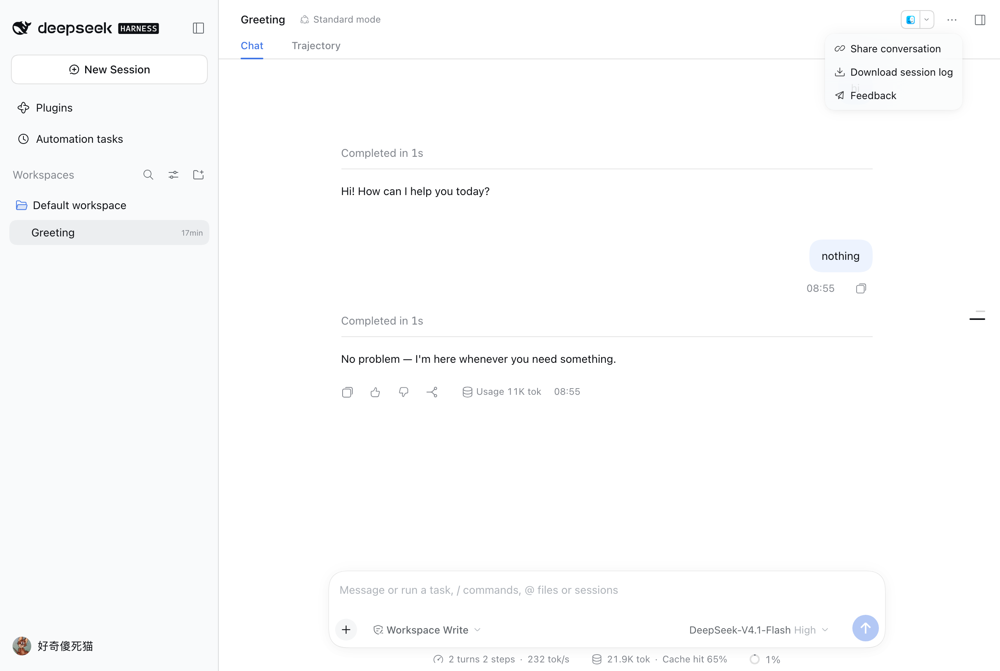
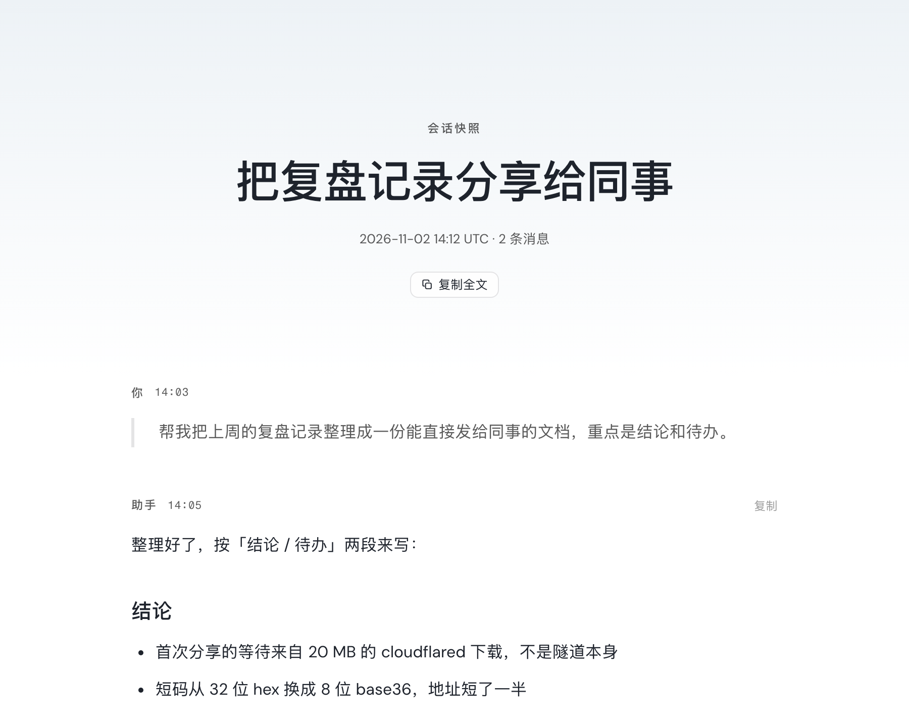
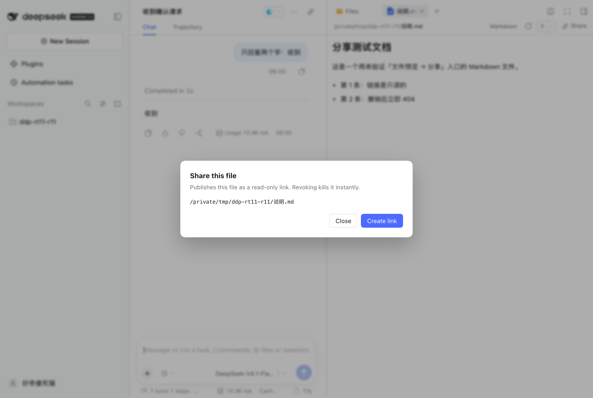
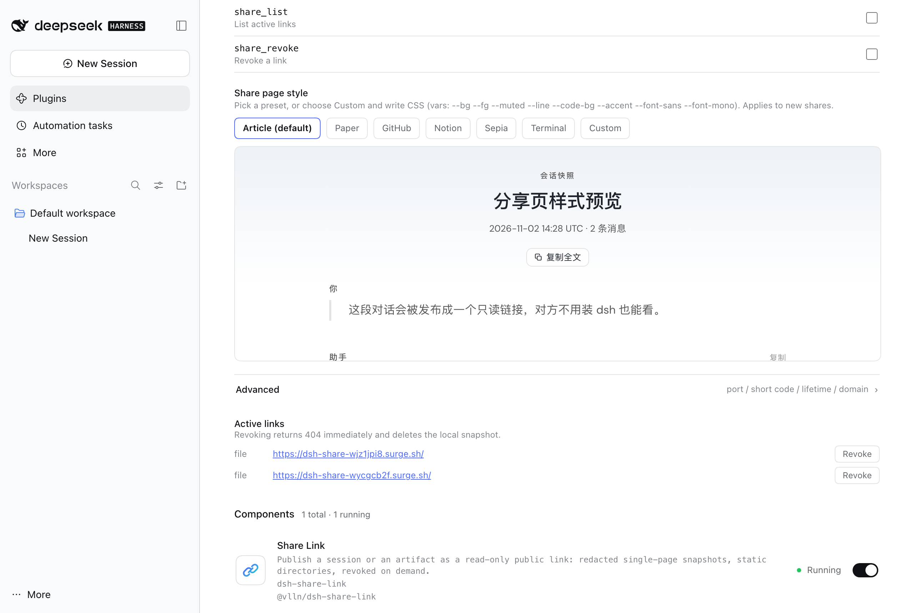

<p align="center">
  <picture>
    <source media="(prefers-color-scheme: dark)" srcset="docs/hero-dark.png">
    
  </picture>
</p>

<h1 align="center">dsh-share-link</h1>

<p align="center"><strong>把一段对话或一个产物，发布成别人点开就能看的只读链接；撤销后立刻失效。</strong></p>

<p align="center">
  <a href="#安装">安装</a> ·
  <a href="#在线样例">在线样例</a> ·
  <a href="#分享怎么到公网">通道</a> ·
  <a href="#常见问题">问答</a> ·
  <a href="#许可">许可</a>
</p>

<p align="center">
  <a href="https://www.npmjs.com/package/@vlln/dsh-share-link"></a>
  <a href="LICENSE"></a>
  <a href="https://github.com/vlln/dsh-share-link/stargazers"></a>
  <a href="#兼容性与已知限制"></a>
</p>

<br>

dsh 跑在本机，产物却经常要给外面的人看：一段对话要发给同事评审、一个页面要在手机上打开、一份报告要给客户。

以前只有两条路，都不太对。**导出成文件再发**，对方拿到附件，手机上体验差，也没法「同一个地址随时更新」；**把整个 dsh 穿透出去**，对方拿到的是你的产品实例——能下指令、能看别的会话。dsh-share-link 补的是第三件事：**单产物 → 链接**，只暴露一个静态目录，在独立端口上跑只读服务，不代理 GUI，不提供写接口。

<br>

## 用起来是什么样

### 分享会话



右上角 `···` → **分享会话** → 选通道 → 生成链接。弹窗里可以临时换通道、决定是否保留工具调用名称，生成后能复制、打开、撤销。

对方打开是这样一篇文章：渐变标题区、640px 正文；提问是带色条的引文，助手回复是正文流，每条都能单独复制，工具调用名称默认不发。



### 分享产物



右侧栏打开文件 → 工具条上的 **Share**。`.html` 挂在链接根路径；`.md` 按 GFM 渲染成可读页面（标题、表格、列表、代码块、图片、链接，以及 README 里 `<h1 align="center">`、`<details>` 这类原始 HTML，过一层标签白名单）；目录会生成文件列表页。

分享 `.md` 时会顺手处理图片：相对路径的图从 md 所在目录树里拷进去，保持相对位置不变；公网图片在发布时抓下来内联成 data URI。所以页面还是「一个文件、离线能开」。

中文、空格、`#` 这类文件名能正常打开（链接会做 URL 编码）；文件是流式发送并支持 Range 的，PDF 与视频可以拖进度条。

### 换一套样式



**版式只有一套**（就是上面那套文章版式），六个预设只换配色与字体：文章（默认）、暖纸、GitHub、Notion、散文、终端。选「自定义」可以写 CSS 覆盖变量：`--bg` `--fg` `--accent` `--font-sans` `--font-mono` 等；`--muted`、`--line`、`--code-bg` 由 `--fg` 派生，通常给三个变量就够。

样式在**发布时固化**：改风格只影响之后的新分享。字体（DM Sans / Fragment Mono）内嵌在页面里，离线也能还原版式，代价是每页固定多约 100 KB；字体授权见 [docs/fonts/OFL.txt](docs/fonts/OFL.txt)。

### 在线样例

两份用默认样式真发出去的页面，可以直接点开看（手机也行），不用装任何东西：

| 样例 | 链接 |
|---|---|
| 会话快照：一场评审整理成「结论 / 要改的点 / 排期」 | https://dsh-share-4q701m8q.surge.sh/ |
| Markdown 文档：列表 / 引用 / 表格 / 代码 / 折叠块 | https://dsh-share-mmslwans.surge.sh/ |

### 让 agent 帮你发

默认关闭。四个工具是**四个独立插件**，不是一个总开关：

| 工具 | 说明 |
|---|---|
| `share_session` | 发布当前会话的只读快照 |
| `share_artifact` | 发布本地文件或目录，可指定通道 |
| `share_list` | 列出还活着的链接与到期时间 |
| `share_revoke` | 按 id 撤销，链接立刻失效 |

在 **Plugins → Share Link → Components** 里按需打开某一行，开关即时生效；反过来，关掉一行就等于关掉那个工具，不需要别的设置。之后就能说「把这段对话分享出去」「把这个页面发个链接给我」。

<br>

## 安装

```bash
dsh plugin --profile web add @vlln/dsh-share-link
```

也可以在 **Plugins → Add plugin** 里填 `@vlln/dsh-share-link`；想跟最新提交而不是发布版，把包名换成 `github:vlln/dsh-share-link`。

装好后侧边栏 **Plugins** 里出现 **Share Link**，点进去顶部是绿色的 `Ready to share`；打开任意会话，右上角 `···` 里多一项 **分享会话**。四个 agent 工具默认关闭，需要时去 Plugins 页的 Components 里打开（见下一节）。

> 从 0.7.3 及更早版本升级：工具原先在设置卡里逐个开关，现在改成四个独立插件。升级后工具会回到关闭状态，需要去 Components 里重新打开；旧的开关配置不再生效。

### 要额外准备什么

| | 用什么 | 没有会怎样 |
|---|---|---|
| **快速隧道** | 一个 `cloudflared` 可执行文件（约 20 MB） | 第一次分享要等下载，期间给进度；也可以自己装 |
| **Surge** | 免费的 Surge 账号（邮箱） | 用不了 Surge 通道，其它通道照常 |
| **命名隧道** | Cloudflare 账号 + 一个你拥有的域名 | 用不了固定域名通道 |

插件加载后就在后台下载 `cloudflared`（跑在 dsh 进程里，退出即停）；也可以自己装一份，macOS 用 `brew install cloudflared`，Windows 用 `winget install --id Cloudflare.cloudflared -e`，装好后插件会直接用 PATH 上那份。设置里填 `cloudflaredPath` / `cloudflaredSha256` 可以指定自己的二进制并校验。

卸载：`dsh plugin --profile web remove @vlln/dsh-share-link`。快照在 `~/.dsh/share-link/`，卸载不会删它们；要让某个链接下架，得先撤销。

## 分享怎么到公网

| 通道 | 地址形态 | 需要什么 | 怎么失效 |
|---|---|---|---|
| 快速隧道 | `https://随机词.trycloudflare.com` | 无 | 停进程 / 撤销 / dsh 重启 |
| Surge | `https://dsh-share-<短码>.surge.sh` | 免费 Surge 账号 | `surge teardown` / 撤销 |
| 命名隧道 | `https://<你的域名>/s/<短码>/` | Cloudflare + 自有域名 | 停进程 / 撤销 |
| 局域网 | `http://<内网 IP>:<port>/s/<短码>/` | 无 | 撤销 |

链接里的短码是 8 位小写 base36（约 41 bit 熵），嫌不够难猜可以在设置页「高级」里调到 10 位（约 52 bit）；旧版 32 位 hex 链接仍然有效。命名隧道不自带公网域名，要在 Cloudflare 的 Routes 里加一条 Public Hostname 指向 `localhost:3089`。

## 安全与数据

- **只读**：只响应 `GET /s/<短码>/…`，没有写接口，不代理 dsh 的 3080。
- **脱敏**：常见凭据形态（`sk-*`、`ghp_*`、`AKIA*`、`Bearer …`、`api_key: …`）与绝对家目录路径会被替换。这是尽力而为，**不是保证**——业务机密、客户名、内网 IP 挡不住，发之前自己过一眼。
- **只留对话**：工具结果正文、思考块、系统提示一律不投影；harness 注入的运行时上下文会被过滤。
- **地址即凭据**：分享服务没有登录态，能不能看全凭地址难猜。发布 1000 条时两条撞码的概率约 2×10⁻⁷，撞了会自动重摇。
- **到期即 404**：有效期过了服务端直接拒绝，不依赖后台清理跑没跑；磁盘上的快照随后清掉。
- **静态、带 CSP**：页面不含第三方脚本，内联脚本只服务于复制按钮；会话页 / `.md` / 目录页都只放行这段脚本的 hash，注入的 `<script>` 与 `onerror=` 执行不了。
- **不越界**：目录分享跳过符号链接；`.md` 引用的公网图片只抓公网地址，内网与回环直接拒绝；原始 HTML 走排版标签白名单。

## 常见问题

<details>
<summary>发出去之后还能改吗？别人能改吗？</summary>

都不能。链接背后是一个静态目录加一段只读的 GET 路由，没有写接口，也不代理 dsh；样式与内容在发布时固化，改预设或重新分享都只影响之后的分享，已经发出去的旧链接不受影响。

但**地址本身就是凭据**：拿到链接的人都能看，转发出去等于又分享了一次。发之前过一眼内容，过期时间别设太长。

</details>

<details>
<summary>链接能一直用吗？刚发出来打不开怎么办？</summary>

看通道。Surge 与命名隧道的地址固定，只要不撤销就一直有效；快速隧道的主机名每次 dsh 重启都会变，旧地址永久失效（启动时这些条目连同快照一起清掉）；局域网地址随端口走，端口随机时不保证下次还通。

`trycloudflare.com` 的 DNS 偶尔滞后几十秒，太早解析还可能把 NXDOMAIN 缓存进本地——等一会儿或换个网络再试，不用重新分享。

</details>

<details>
<summary>支持 Windows 吗？</summary>

支持，但只在 macOS 上做过真机验证。Windows 的 cloudflared 下载、`npx` 回退、路径分隔符都有独立分支，代码路径齐全，未真机回归。

</details>

## 兼容性与已知限制

<details>
<summary>已验证的环境</summary>

| 环境 | 状态 |
|---|---|
| dsh `0.2.1-rc.1` | ✅ 验证过：安装、会话/文件发布、撤销、真实公网访问 |
| 同上 · dsh-better-sidebar `0.28.0` | ✅ 文件预览被它接管后，分享按钮出现在它的编辑器页头 |
| 同上 · Surge | ✅ 真实账号：发布 → 公网 200 → `surge teardown` → 404 |
| 同上 · 命名隧道 | ⚠️ 隧道可连、参数正确；账号里没有可用域名，公开访问未验证 |
| 其它 dsh 版本 | ⚠️ 未验证——升级后若入口不出现，多半是插槽名或工具契约变了 |

</details>

<details>
<summary>已知限制</summary>

- **局域网通道目前只听回环地址**，别的设备打不开；短期请用 Surge 或快速隧道。
- 快速隧道的域名压不下去（Cloudflare 随机给），短码只缩短路径段；要 `s.你的域名/xxxx` 这种短链必须用命名隧道。
- 下载完成后的**第一次**快速隧道分享还要 5–10 秒（cloudflared 要连 Cloudflare 拿主机名），之后同一进程内再分享是零点几秒。
- 目录入口页只列文件，不列空目录；单次分享上限 100 MB / 2000 个文件。
- 会话快照只含「人类输入 + 助手可见文本」，没有工具调用详情视图。
- `.md` 的图片有上限：只拷同目录树内的文件（`../` 越界忽略）、最多 24 张公网图、单张 ≤ 2 MB、合计 ≤ 8 MB；抓不到的内联不了，会退回外链。
- 文件名里的符号链接不会进分享。

</details>

## 许可

MIT（SPDX：`MIT`），见 [LICENSE](LICENSE)。随包内嵌的字体 DM Sans 与 Fragment Mono 是 SIL OFL 1.1，授权原文见 [docs/fonts/OFL.txt](docs/fonts/OFL.txt)。
