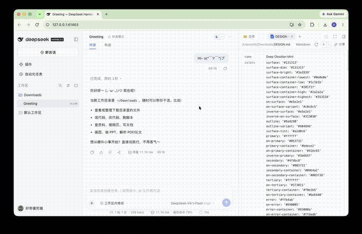

# dsh-share-link

<p align="center">把一段对话或一个产物，发布成只读的公网链接——对方点开就能看，撤销后立即失效。</p>

<p align="center">
  <a href="https://www.npmjs.com/package/@vlln/dsh-share-link"></a>
  <a href="https://github.com/vlln/dsh-share-link/stargazers"></a>
  <a href="https://github.com/vlln/dsh-share-link/blob/main/LICENSE"></a>
  
</p>

## 30 秒安装

**在 dsh web 里**：侧边栏 **Plugins → Add plugin**，输入 `@vlln/dsh-share-link`，点安装。

**用 CLI**：

```sh
dsh plugin --profile web add @vlln/dsh-share-link
# 装完重启 dsh web 生效
```

> 尚未发布到 npm 时，用仓库里的 tarball：`pnpm build && pnpm pack`，然后
> `dsh plugin --profile web add ./vlln-dsh-share-link-0.1.0.tgz`。

- **前置**：dsh `>= 0.2.0`；macOS / Linux 已验证，Windows 代码路径已实现但**未在真机验证**
- **零配置可用**：默认走云端快速隧道，首次分享会自动下载 `cloudflared`（约 50 MB，需要能访问 GitHub）
- **卸载**：`dsh plugin --profile web remove @vlln/dsh-share-link`

### 装好之后怎么确认

- 侧边栏 **Plugins** 列表里出现 **Share Link**，点进去有一条绿色的 `Ready to share`
- 打开任意会话，右上角 `···` 菜单里多一项 **分享会话**

## 为什么需要它

dsh 跑在本机，产物却经常要给外面的人看：一段对话要发给同事评审、一个 HTML 页面要在手机上打开、一份报告要给客户。

现在只有两条路，都不对：

- **导出成文件再发**——对方拿到的是附件，手机上体验差，也没法"同一个地址随时更新"；
- **把整个 dsh 穿透出去**——别人拿到的是你的**产品实例**（能下指令、能看别的会话），而不是**这一个产物**。

这个插件补的是第三件事：**单产物 → 链接**。它只暴露一个静态目录，在独立端口上跑只读服务，不代理 GUI、不提供写接口。链接的生命周期绑定在本地服务 + 一条隧道上——停服务或点撤销，链接立刻 404。

## 用起来是什么样



<sub>完整 26 秒（含切换通道与打开发布页）：[docs/demo.mp4](docs/demo.mp4)</sub>

### 分享会话


右上角 `···` → **分享会话** → 选通道 → 生成链接。


弹窗里可以直接切换通道、选择是否保留工具调用名称；生成后能复制、打开、撤销。

对方打开是这样一份对话快照——你的提问靠右成气泡，助手回复是正文流，每条回复可单独复制：


### 分享产物


右侧栏打开文件 → 工具条上的 **Share**。`.html` 挂在链接根路径；`.md` 渲染成可读页面；目录会生成文件列表页。

### 配置与样式


侧边栏 **Plugins → Share Link**：

| 区域 | 它回答什么问题 |
|---|---|
| 顶部状态条 | 现在能不能分享、缺什么 |
| 默认通道（下拉） | 分享弹窗默认选哪个通道 |
| 渠道配置卡 | 每个通道自己的参数，互不排斥；没配好的自动展开并给步骤与官方入口 |
| 分享页样式 | 5 个预设 + 自定义 CSS，带实时预览 |
| 已发布的链接 | 哪些还活着、一键撤销 |


| 预设 | 参考 | 观感 |
|---|---|---|
| 暖纸（默认） | 长文阅读 | 米白底、无衬线、蓝色强调 |
| GitHub | GitHub 文档排版 | 纯白、细边框、系统字体 |
| Notion | Notion 页面 | 大标题、无边框、超大留白 |
| 散文 | 书籍排版 | 衬线、米色、行高 1.95 |
| 终端 | 编辑器暗色 | 等宽字体、深底、绿色强调 |

选「自定义」可以写 CSS 覆盖这些变量：`--bg` `--fg` `--muted` `--line` `--code-bg` `--accent` `--star`。

## 能力面

| 工具 | 说明 |
|---|---|
| `share_session` | 把当前会话发布成只读快照（脱敏、去掉注入上下文） |
| `share_artifact` | 发布本地文件或目录；可指定通道 |
| `share_list` | 列出活跃链接、类型与到期时间 |
| `share_revoke` | 按 id 撤销，链接立即失效、快照从磁盘删除 |

## 通道

| 通道 | 地址形态 | 需要什么 | 撤销 |
|---|---|---|---|
| 快速隧道（推荐） | `https://随机词.trycloudflare.com` | 无（首次自动下载 cloudflared） | 停服务 / 撤销 |
| Surge | `https://dsh-share-<id>.surge.sh` | 免费 Surge 账号（邮箱） | `surge teardown` |
| 命名隧道 | `https://<你的域名>/s/<id>/` | Cloudflare 账号 + **托管在 CF 的域名** | 停服务 / 撤销 |
| 局域网 | `http://<内网 IP>:<port>/s/<id>/` | 无 | 撤销 |

> 命名隧道本身不自带公网域名：必须在 Cloudflare 的 Routes 里加一条 Public Hostname 指向 `localhost:3089`。没有域名就用 Surge 或快速隧道。

## 配置

| 项 | 默认 | 说明 |
|---|---|---|
| `defaultChannel` | `quick` | 弹窗默认通道：`quick` / `surge` / `named` / `lan` |
| `port` | `0` | 只读服务端口，0 = 随机；命名隧道模式自动用 3089 |
| `ttlHours` | `168` | 默认有效期（小时）；撤销是立即失效 |
| `pageTheme` | `paper` | 分享页风格：`paper` / `github` / `notion` / `sepia` / `terminal` / `custom` |
| `pageThemeCss` | 空 | 自定义 CSS，追加在预设之后 |
| `surgeToken` / `surgeLogin` / `surgeDomain` / `surgePrefix` | 空 | Surge 通道参数 |
| `tunnelToken` / `tunnelHostname` | 空 | 命名隧道参数 |
| `cloudflaredPath` | 空 | 已有 cloudflared 的路径 |

全部在 **Plugins → Share Link** 里改，即时生效（不需要重启）；也可以在 profile patch 的 `config:` 里写。

## 安全与数据

- **只读**：分享服务只绑 `127.0.0.1`，只响应 `GET /s/<token>/…`，没有写接口，不碰 dsh 的 3080。
- **脱敏**：常见凭据形态（`sk-*`、`ghp_*`、`AKIA*`、`Bearer …`、`api_key: …`）与绝对家目录路径会被替换；这是尽力而为，**不是保证**——业务机密、客户名、内网 IP 挡不住，分享前请自己过一眼。
- **只留对话**：工具结果正文、思考块、系统提示一律不投影；harness 注入的运行时上下文会被过滤。
- **凭据**：只作为子进程环境变量使用（`SURGE_TOKEN`），不写日志、不入库。
- **快照是静态的**：不加载任何外部资源；内联脚本只服务于复制按钮。

## 已知限制

- **Windows**：`cloudflared.exe` 下载、`.exe/.cmd` 的 PATH 查找、`npx.cmd` 调用都已按 Windows 处理，但没有在 Windows 机器上跑过——遇到问题请开 issue 附报错。dsh 本体在 Windows 上的兼容性另见社区插件 `dsh-win32`。
- 快速隧道的域名每次重启都会变；要固定地址请用 Surge 或命名隧道。
- 样式在**发布时固化**：改风格只影响之后的新分享。
- 目录入口页只列文件，不列空目录；单次分享上限 100 MB / 2000 个文件。
- 会话快照只含「人类输入 + 助手可见文本」，没有工具调用详情视图。

## 兼容性

| dsh 版本 | 状态 |
|---|---|
| `0.2.1-rc.1` | ✅ 已验证（2026-10-20）：装包、boot、会话/文件发布、撤销、真实公网访问；两个入口都在真实浏览器里逐屏点过 |
| 同上 · Surge 通道 | ✅ 真实账号验证：发布 → 公网 200 → `surge teardown` → 404 |
| 同上 · 命名隧道 | ⚠️ 隧道可连、参数与端口正确；未取得公网域名，公开访问这一段未验证 |
| 其它版本 | ⚠️ 未验证——升级后若入口不出现，多半是 slot 名或 `defineTool` 契约变了 |

## 插件管理

装/卸/启停用官方 CLI：`dsh plugin --profile web add|remove <包>`；已装插件在**侧边栏 Plugins 页**里查看与配置。

## License

MIT
